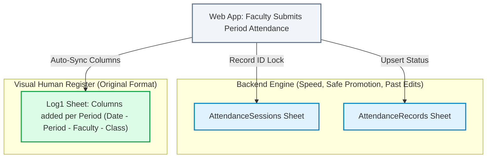

# Attendance App: Complete Architecture, System Guide & Deployment Reference

A production-grade, mobile-first Google Apps Script web application paired with Google Sheets for high-speed college period attendance, batch promotion, error correction, and instant reporting.

Spreadsheet Database ID: `1K2VTTCSi97ctLBo3KEKtJ9rxsHBJkT1z0TEpmiA7guQ`  
Apps Script Project ID: `12kaHQ0sKp36fHamuUnNrFXvzO71UPKcgyCewclbG90NKE-1cDP2OFXhd`  
Active Production Deployment (@15): `AKfycbxScxEhMYpky7FzhwwjQoaQw8StxkOJ9PAGysMxOme0OtRI7WaSlothNVc5vwud8HvX`  
Live Web App URL: https://script.google.com/macros/s/AKfycbxScxEhMYpky7FzhwwjQoaQw8StxkOJ9PAGysMxOme0OtRI7WaSlothNVc5vwud8HvX/exec

---

## 1. The Hybrid Architecture (Option A: Best of Both Worlds)

The system pairs a **relational, tamper-proof backend database** with an **automatically synchronized visual columnar register (`Log1`)**:



### Why This is Ideal:
1. **Direct Google Sheets Viewing**:
   Whenever a faculty member or HOD opens the Google Sheet directly on a phone or laptop, the `Log1` sheet displays a physical, horizontal register book:
   - **Col A:** `Register No`
   - **Col B:** `Name`
   - **Col C:** `Roll No`
   - **Col D:** `Class`
   - **Col E, F, G...:** `2026-11-20 - Period 1 - Prof. Smith - S1 FYUGP Botany` with student attendance cells marked `P`, `A`, or `L`.
2. **Zero Inconsistency on Edits**:
   If a faculty member edits an earlier period in the web app, the backend updates `AttendanceRecords` **and immediately updates that exact period column in `Log1`**.
3. **Infinite Scalability**:
   - Google Sheets has a capacity of **10,000,000 cells**.
   - An entire academic year of attendance uses only $\approx 1.2\%$ of this limit.

---

## 2. Zero-Data-Loss Academic Promotion Architecture

When a cohort finishes a semester (e.g., **S1 FYUGP Botany** $\rightarrow$ **S2 FYUGP Botany**), the system allows faculty or administrators to promote the entire batch (or selected students) seamlessly:

1. **Permanent Primary Key (`StudentId`)**:
   Every student receives an immutable UUID upon import (e.g. `stu_m8b9f1...`). Register numbers (`Reg No`) can be changed or corrected at any time without orphaning past attendance.
2. **Session-Level Isolation**:
   Every attendance session logged in `AttendanceSessions` is permanently stamped with the `ClassId` at the time of recording (e.g. `s1_fyugp_botany`).
3. **Compound Record Key**:
   Individual student attendance status is keyed as `${SessionId}_${StudentId}` in `AttendanceRecords`.
4. **Historical Query Integrity**:
   - Querying **S1 FYUGP Botany** in the Reports tab queries all sessions where `ClassId = s1_fyugp_botany`. It continues to show the exact attendance percentage and hours earned during Semester 1.
   - When marking attendance for **S2 FYUGP Botany**, only students currently enrolled in S2 appear, starting fresh with zero hours and no overlapping sessions.
5. **Class Archiving**:
   Selecting *"Archive source class"* marks the old semester as `Archived` in the `Classes` sheet. It immediately hides the completed class from daily period marking dropdowns while remaining available in the Reports tab for official auditing.
6. **Automatic `Log1` Class Update**:
   Upon promotion, Column D (`Class`) in `Log1` is automatically updated to the new class name for all promoted students.
7. **Re-using Archived Class Names for New Batches**:
   When the next academic intake arrives, the archived class name (e.g. `S1 FYUGP Botany`) is clearly listed under `<optgroup label="Archived Classes (Reactivate for New Batch)">` in the **Import Tab**.
   - Selecting it and uploading the new student roster automatically switches the class status back to **Active**.
   - The newly enrolled batch appears immediately in the daily marking dropdowns.
   - All past attendance history recorded for the previous batch remains 100% frozen, queryable via date-filtered Reports.

---

## 3. Data Maintenance & Reset Engine

For year-end cleanup or testing environments, administrators have access to safe, class-isolated reset tools:

| Mode | Impact on Attendance | Impact on Student Roster | Impact on Class Definition | Impact on `Log1` |
| :--- | :--- | :--- | :--- | :--- |
| **Clear Attendance Sessions Only** | Deletes all marked sessions and records for this class. | **Preserved 100%** (Students stay enrolled in class). | **Preserved 100%**. | Removes period columns for this class in `Log1`. |
| **Complete Purge** | Deletes all marked sessions and records for this class. | **Deleted** (Students enrolled in this class are removed). | **Deleted** (Class removed from system). | Deletes columns and student rows for this class in `Log1`. |

### Safety Protections:
- **Strict Isolation**: Records belonging to other classes are never touched.
- **Type-to-Confirm Safeguard**: To prevent accidental clicks, the modal requires the administrator to type `DELETE` in capital letters before the server executes the command.
- **Server-Side Concurrency Locking**: Google Apps Script's `LockService.getScriptLock()` prevents race conditions while modifying rows in Google Sheets.

---

## 4. Live Customization of College & Portal Settings

Administrators can update key institutional configuration items live from the UI without touching Google Sheets formulas or code:

1. **College / Institution Name (`COLLEGE_NAME`)**:
   - Updates the top header of the web portal.
   - Updates the official printable register document and signature headers.
2. **Portal Subtitle / Department (`PORTAL_TITLE`)**:
   - Updates the topbar subtitle (e.g., `Department of Botany`).
3. **Min Attendance % Threshold (`MIN_ATTENDANCE_PERCENT`)**:
   - Changes the threshold for low attendance warnings in the Reports tab (e.g., `75%`).
   - Students below this threshold are automatically highlighted in red with warning badges.

---

## 5. Ready-to-Import University Examination Rosters

Three clean Excel roster files have been extracted from official University Examination Registration reports and saved directly in the project directory:

1. `BSc_Botany_S1_Roster.xlsx`: 32 Candidates (`CHBASBO001` to `CHBASBO032`)
2. `BSc_Botany_S3_Roster.xlsx`: 30 Candidates (`CHAZSBO001` to `CHAZSBO030`)
3. `BSc_Botany_S5_Roster.xlsx`: 23 Candidates (`CHAYSBO002` to `CHAYSBO032`)
4. `Student_Roster_Template.xlsx`: Reusable blank/sample import template

---

## 6. Professional UI Revamp & Feature Architecture (Version 13)

### 1. Unified Mark & Edit Attendance Workspace (`tab-mark`)
- **Seamless In-Place Past Attendance Editing**: Faculty no longer need to switch to a separate tab to review or edit past attendance. Selecting a **Class**, **Date**, and **Period** automatically queries the database:
  - **Existing Session Detected**: Displays a clear status banner (`⚡ Previous Session Loaded: Recorded by {Faculty Email}`) and loads saved student attendance statuses directly into the interface. The action button switches to *"Save Attendance Changes"* (emerald green).
  - **New Session**: Displays `🟢 New Attendance Session`, defaults all enrolled students to **Present (P)**, and sets the button to *"Submit Attendance"* (blue).
- **Date Auto-Fill on Load**: The Date field always defaults to today's date in local time (`YYYY-MM-DD`). A quick *"Today"* pill button beside the Date label allows one-tap reset if another date was previously selected.

### 2. Dedicated Student Directory & Record Editor (`tab-edit`)
- **Clean Student Management**: Dedicated tab (`👥 Edit Students`) designed for both **Faculty** and **Admin**.
- **Real-Time Search & Roster Count**: Filter students instantly across active and archived cohorts by Student Name, Register Number, or Roll Number.
- **In-Place Record Correction**: Clicking *"Edit"* (or ✏️) opens the *Edit Student Record* modal to fix typos in `Reg No`, `Name`, or `Roll No`.
- **Permanent System UUID Keying**: Records are bound to an immutable `studentId`, guaranteeing that correcting a typo never breaks past attendance records or `Log1` registers.

### 3. Clean Import Roster Tab (`tab-import`)
- Roster management has been cleanly separated: the Import tab now focuses purely on uploading rosters via Excel/CSV with drag-and-drop, smart column detection, preview, and automatic one-click navigation to the Student Directory upon import completion.

### 4. Pure 3-State Attendance Model ($P, A, L$)
- Streamlined to strictly **P** (Present), **A** (Absent), and **L** (Late).
- **Attendance Percentage Calculation Rule**: Late ($L$) is credited as Present ($P$) in academic compliance:
  $$\text{Effective Present Hours} = \text{Present} + \text{Late}$$
  $$\text{Attendance Percentage} = \frac{\text{Present} + \text{Late}}{\text{Total Sessions Conducted}} \times 100\%$$
- **Shortage Warning**: Students below the configured threshold (e.g., $75\%$) are highlighted in bold red badges across reports and downloads.

---

## 7. File Structure & Deployment Guide

```
D:\AttendanceAppSheet/
├── Code.gs                   # Backend entry point, DB schema initialization, setupDatabase()
├── Auth.gs                   # Authentication, auto-seeding owner as Admin, RBAC enforcement
├── Attendance.gs             # Marking, past editing, batch promotion, data clearing, reports
├── AttendanceApp.html        # Single-page application UI structure, Tailwind CSS, modals
├── ClientScript.html         # Front-end state engine, SheetJS parsing, DOM controllers
├── appsscript.json           # Google Apps Script manifest file (V8 engine, timezone)
├── README.md                 # Complete system guide & documentation (this file)
├── BSc_Botany_S1_Roster.xlsx # Extracted clean import roster for S1 Botany
├── BSc_Botany_S3_Roster.xlsx # Extracted clean import roster for S3 Botany
├── BSc_Botany_S5_Roster.xlsx # Extracted clean import roster for S5 Botany
└── Student_Roster_Template.xlsx # Standard template for importing rosters
```

### Steps to Deploy to Google Apps Script:
1. Open the linked Google Sheet: [https://docs.google.com/spreadsheets/d/1K2VTTCSi97ctLBo3KEKtJ9rxsHBJkT1z0TEpmiA7guQ](https://docs.google.com/spreadsheets/d/1K2VTTCSi97ctLBo3KEKtJ9rxsHBJkT1z0TEpmiA7guQ)
2. Go to **Extensions** > **Apps Script**.
3. Copy/paste or push the 5 core files:
   - `Code.gs`
   - `Auth.gs`
   - `Attendance.gs`
   - `AttendanceApp.html`
   - `ClientScript.html`
   - `appsscript.json` (Project Settings > Check "Show 'appsscript.json' manifest file in editor")
4. In the Apps Script editor, run `setupDatabase()` once to create/verify all database sheets (`_Config`, `Users`, `Classes`, `Students`, `AttendanceSessions`, `AttendanceRecords`, `Log1`).
5. Click **Deploy** > **New deployment** > Select type: **Web app**:
   - **Execute as**: *User accessing the web app*
   - **Who has access**: *Anyone* (Access is controlled internally by Google Account email authentication in `Auth.gs`).
6. Copy the Web App URL and open on phone or desktop!

---

## 8. Built-in Google Sheets Extension Menu (`onOpen`)

Faculty and administrators do **not** need to open Google Apps Script to use the application. Whenever the spreadsheet is opened, a custom menu appears directly in the Google Sheets menu bar:

```
Google Sheets Menu Bar
├── File
├── Edit
├── View
├── Insert
├── Format
├── Data
├── Tools
├── Extensions
└── 📋 Attendance App   <--- Built-in Extension Menu
    ├── 🚀 Launch Attendance Portal (Full-screen interactive dialog)
    ├── 📱 Open in Sidebar (Docked alongside the sheet on the right)
    ├── ──────────────────────────────────
    ├── ⚙️ Initialize / Verify Database (Run one-click verification)
    └── 🌐 Web App Mobile Link (Retrieve smartphone standalone link)
```

---

## 9. Minor / MDC Home Department & Student Lifecycle (Add & Remove)

### 1. Minor / MDC Home Department Field
- **Home Department Students**: The `Department` field is left blank. The system automatically displays them as regular department students without extra tags.
- **Minor / Multidisciplinary Course (MDC) Students**: For students attending from other departments (e.g. Chemistry, Physics, Commerce), their home department is stored in Column 7 of the `Students` sheet.
- **Consistent Surfacing**:
  - **Mark & Edit Tab**: Displays a distinct purple badge `Chemistry` next to their register number.
  - **Student Directory (Edit Tab)**: Shows the department badge with inline editing support.
  - **Reports (Desktop & Mobile)**: Dedicated `Home Dept` column and mobile card tag.
  - **Excel & Print Exports**: Includes `Home Department` in downloaded spreadsheets and the printable register.
  - **Excel / CSV Import Templates**: `Student_Roster_Template.xlsx` and `.csv` include the `Department` column with smart header detection (`department`, `dept`, `homedept`, `major`).

### 2. Student Add & Remove with Permanent Historical Preservation
- **Add Student**:
  - Use the `+ Add Student` button in the **Edit Tab**.
  - Generates an immutable UUID key `STU_...`, checks for duplicates, enrolls the student into the class roster, and immediately syncs them to `Log1`.
- **Remove Student**:
  - Clicking **Remove** in the **Edit Tab** prompts for confirmation.
  - **Zero-Data-Loss Rule**:
    - If the student has **any past attendance sessions on file** (in `AttendanceRecords` or marked in `Log1`), the student is soft-deactivated to `Status = "Inactive"`.
    - The student is removed from daily attendance dropdowns and new session rosters, but **100% of their historical records remain intact**.
    - When viewing or editing an **existing/past attendance session**, the student is seamlessly reloaded with their recorded status (`P`/`A`/`L`) and an `Inactive (Past Record)` badge.
    - In **Attendance Reports**, any inactive student who attended classes during the filtered date range remains in the report, with their total hours and attendance percentage fully accounted for.
    - In the visual columnar register (`Log1`), all past columns and attendance marks are permanently retained.
    - If a student had **zero recorded attendance**, their row is cleanly removed from the database.

---

## 10. Bulk Register Number Changes via Excel Export & Upload

Colleges often enroll new batches using temporary admission numbers (e.g. `ADM2026001`), and later receive the official University Register Numbers (e.g. `CHBASBO001`). The system enables safe, bulk updating without orphaning past attendance data:

### Workflow:
1. **Export for Bulk Edit (`📥 Export Excel`)**:
   - In the **👥 Edit Students** tab, choose the class and click **📥 Export Excel**.
   - An Excel workbook (`[ClassName]_Bulk_Edit_Roster.xlsx`) is generated and downloaded instantly with columns:
     - `Student Key (Do Not Change)`: The student's permanent system UUID (e.g. `STU_9A8B7C...`).
     - `Register No`: Editable column for University Register Numbers.
     - `Student Name`: Editable student name.
     - `Roll No`: Editable class roll number.
     - `Home Department`: Editable minor/MDC department.
2. **Edit in Excel**:
   - Open the file in Microsoft Excel or Google Sheets.
   - Paste or correct the Register Numbers in the `Register No` column.
   - Save the workbook.
3. **Upload Bulk Changes (`📤 Upload Bulk`)**:
   - In the **👥 Edit Students** tab, click **📤 Upload Bulk**.
   - Choose or drop the edited file.
   - The browser parses the file, matches students against the active roster, and displays a **Live Diff Preview Table**:
     - Columns: `Current Reg No` $\rightarrow$ `New Reg No (⚡)`, `Student Name`, `Roll No`, `Home Dept`.
     - Highlights all detected register number changes in amber.
4. **Apply Bulk Changes**:
   - Clicking **Apply Bulk Changes** runs `bulkUpdateStudentRoster` in Google Apps Script.
   - **Zero Data Loss Guarantee**:
     - The underlying primary key (`StudentId`) is **never modified**.
     - `Students` sheet is updated with the new Register Numbers.
     - `AttendanceRecords` sheet updates the human-readable `RegNo` column, keeping all historical record IDs intact.
     - `Log1` (visual columnar register) updates Column 1 (`Register No`), while **all historical period columns and past marks (`P`/`A`/`L`) remain completely preserved**.

